# Cartoon V1 — Original runtime artwork

These **are the individual, editable SVGs shipped to Phaser** — not crops of the promotional mockup. They are first-pass cartoon sprites, with procedural bob/tilt instead of final directional animation atlases.

## Eight playable heroes (click the image to view its source)
| | | | |
|---|---|---|---|
| 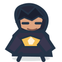 | 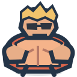 | 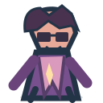 | 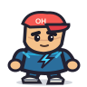 |
| The Sigma | Alpha Chad | The Rizzler | Ohio Kid |
| 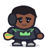 | 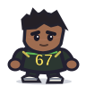 | 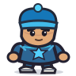 |  |
| Fanum Lord | Six Seven Kid | Cool Kid | Nerd |

## Four current enemy families
| NPC | Hater | Beta Bro | Big Hater |
|---|---|---|---|
| 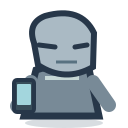 | 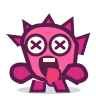 | 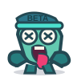 | 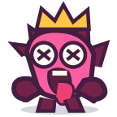 |

## One playable arena skin
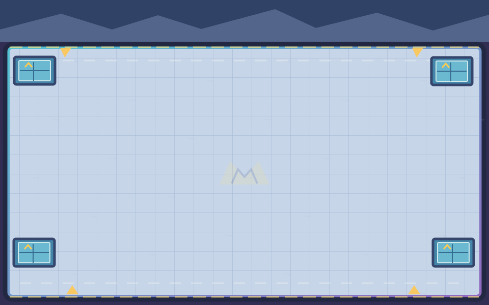

This is a background skin: the proposed **three larger scrolling maps**, all obstacle interactions and the evolved form atlases are intentionally NOT added by this art-only PR.

[Technical integration plan](CARTOON_V1_INTEGRATION.md) · [Full asset directory](../../public/assets/cartoon/v1/README.md)
